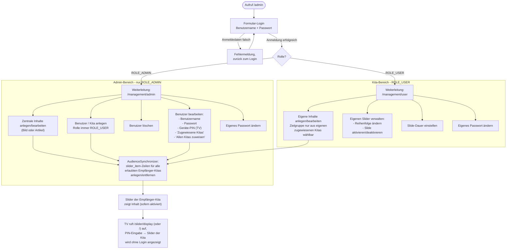
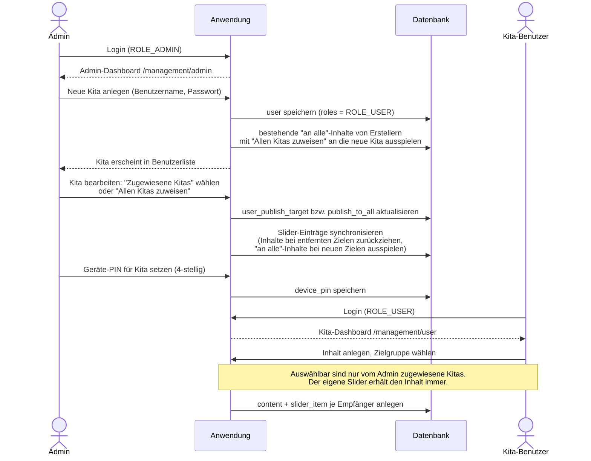
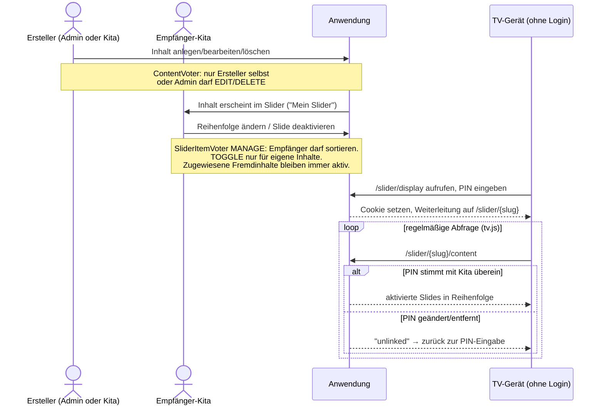
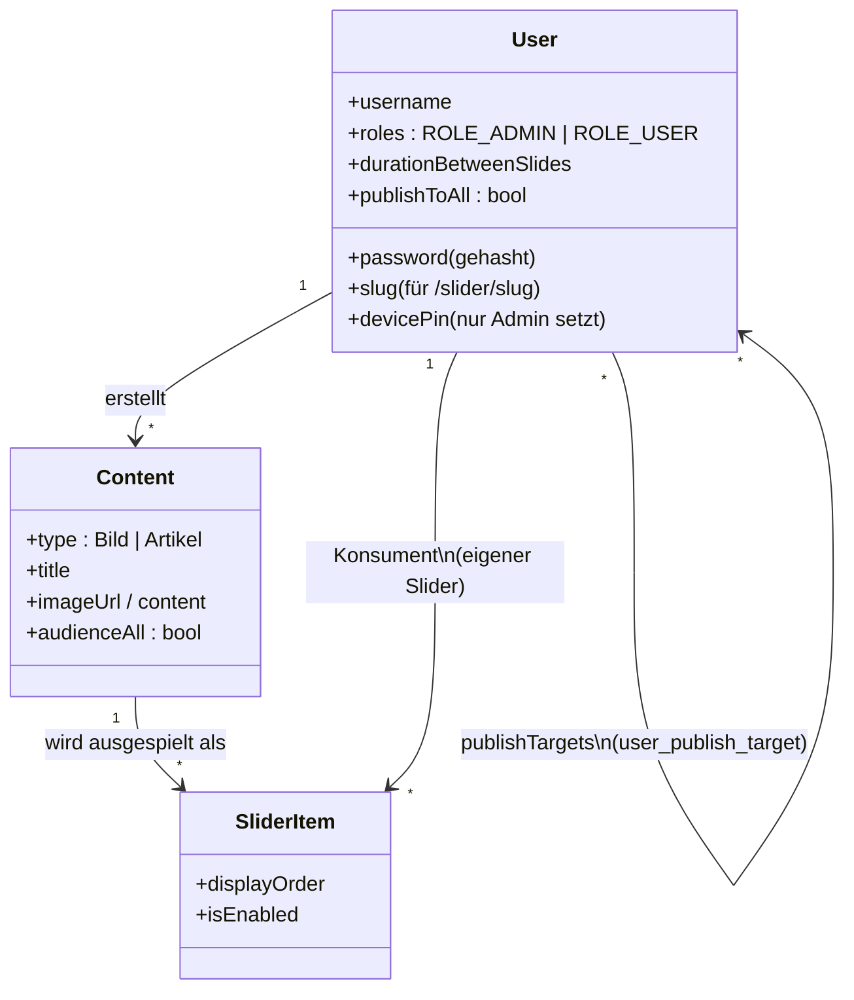

# Autorisierung & Benutzerverwaltung – Testreferenz

Dieses Dokument beschreibt den Soll-Flow der Anwendung rund um **Login, Rollen, Benutzerverwaltung (Admin), zugewiesene Kitas und Slider**. Es dient Anwendern als Anhaltspunkt für Funktionstests.

## Grundprinzip

- Es gibt genau zwei Rollen: `ROLE_ADMIN` (Administrator) und `ROLE_USER` (eine Kita).
- **Jede Kita ist ein Benutzerkonto** – es gibt keine separate Kita-Entität.
- Der Admin verwaltet alle Benutzer und legt fest, **welchen Kitas ein Ersteller Inhalte zuweisen darf** ("Zugewiesene Kitas" bzw. "Allen Kitas zuweisen").
- Jede Kita hat genau **einen Slider** (TV-Anzeige), der per 4-stelliger PIN mit einem oder mehreren Geräten gekoppelt wird.

---

## 1. Gesamt-Flow: Login → Rolle → Berechtigungen (Aktivitätsdiagramm)

**Hinweis für Tests:** Die Anmeldung liegt unter `/admin`; `/login` leitet dauerhaft (301) dorthin um. Ein Admin, der `/management/user` aufruft, wird automatisch auf `/management/admin` umgeleitet. Eine Kita, die `/management/admin` aufruft, erhält **403 Access Denied** (`access_control` verlangt `ROLE_ADMIN`).

---

## 2. Benutzerverwaltung & Kita-Zuweisung (Sequenzdiagramm)

---

## 3. Slider: Wer darf was? (Sequenzdiagramm inkl. TV)

---

## 4. Datenmodell (Klassendiagramm)

---

## 5. Checkliste für Funktionstests

### Login & Rollen
- [ ] Login mit falschen Daten schlägt fehl, Fehlermeldung erscheint.
- [ ] Admin landet nach Login auf `/management/admin`, Kita auf `/management/user`.
- [ ] Groß-/Kleinschreibung des Benutzernamens spielt beim Login keine Rolle (`KITA-A` meldet `kita-a` an).
- [ ] Wer bereits angemeldet ist und `/admin` aufruft, landet direkt im eigenen Dashboard.
- [ ] Kita kann `/management/admin` nicht aufrufen (403 Access Denied).
- [ ] Admin wird von `/management/user` auf das Admin-Dashboard umgeleitet.
- [ ] Eine Kita kann über "Anleitung" in der Kopfzeile das Benutzerhandbuch als PDF herunterladen; der Admin sieht den Link nicht, ohne Anmeldung führt die Adresse zur Anmeldung.
- [ ] Logout beendet die Sitzung.
- [ ] Mit "Angemeldet bleiben" bleibt die Anmeldung 30 Tage bestehen, auch nach dem Schließen des Browsers; ohne den Haken endet sie mit der Sitzung.
- [ ] Passwortfelder lassen sich über das Augen-Symbol im Klartext anzeigen und wieder verbergen.
- [ ] Der Umschalter in der Kopfzeile wechselt zwischen hellem und dunklem Design; die Wahl bleibt auf dem Gerät gespeichert, ohne Wahl gilt die Geräteeinstellung.

### Benutzerverwaltung (nur Admin)
- [ ] Admin kann neue Kita anlegen; sie erscheint in der Benutzerliste.
- [ ] Ab neun Kitas steht über der Liste ein Suchfeld; es blendet alle Kitas aus, deren Name den Suchtext nicht enthält.
- [ ] Der Benutzername ist Pflicht und darf keinen Schrägstrich enthalten. Ein Name, der dieselbe Slider-Adresse ergäbe wie ein vorhandener (z. B. "Kita A" neben "kita-a"), wird abgelehnt.
- [ ] Admin kann Passwort einer Kita ändern.
- [ ] Admin kann das eigene Passwort im Dashboard ändern (aktuelles Passwort erforderlich).
- [ ] Admin kann einer Kita eine 4-stellige Geräte-PIN zuweisen; PIN muss eindeutig sein.
- [ ] Admin kann in der Kita-Liste mehrere Kitas ankreuzen und ihnen mit "Neue PINs vergeben" zufällige, systemweit eindeutige PINs geben (nach Rückfrage). Ausgefilterte Kitas sind nie Teil der Auswahl.
- [ ] Admin kann einer Kita "Zugewiesene Kitas" geben oder "Allen Kitas zuweisen" aktivieren.
- [ ] Admin kann Kita löschen; deren Inhalte, Slider-Einträge und Zuweisungen (als Ersteller wie als Ziel) verschwinden.
- [ ] Admin kann mehrere angekreuzte Kitas mit "Ausgewählte löschen" auf einmal löschen (nach Rückfrage); Admin-Konten in der Auswahl werden übergangen.
- [ ] Admin-Konten lassen sich nicht löschen.

### Inhalte & Zuweisung
- [ ] Kita sieht bei "Sichtbar für ausgewählte Kitas" nur die vom Admin zugewiesenen Kitas (sich selbst nicht – der eigene Slider erhält den Inhalt immer). Ohne zugewiesene Kitas erscheint keine Zielgruppen-Auswahl.
- [ ] Zentrale Inhalte des Admins erscheinen im Slider aller erlaubten Kitas.
- [ ] Entzieht der Admin einer Kita ein Ziel, verschwinden dort die bereits ausgespielten Inhalte dieses Erstellers.
- [ ] Nur der Ersteller (oder Admin) kann einen Inhalt bearbeiten/löschen.
- [ ] Eigene Inhalte stehen mit dem neuesten zuerst. Listen mit mehr als zwölf Einträgen werden nicht länger als der Bildschirm und lassen sich in ihrem Feld scrollen.
- [ ] Artikeltext behält die Formatierung des Editors (Überschriften, fett, kursiv, Listen). Skripte, Bilder, Links und sonstiges eingefügtes HTML werden entfernt; der Text darin bleibt erhalten.
- [ ] Fotos erscheinen aufrecht, auch wenn die Drehung nur in den Bilddaten (EXIF) vermerkt ist.

### Slider
- [ ] Kita kann die Reihenfolge der Slides im eigenen Slider ändern: Zeile am Griff ziehen (Maus oder Finger) oder Griff fokussieren und Pfeiltasten hoch/runter drücken. Die Reihenfolge wird sofort gespeichert.
- [ ] Kita kann eigene Inhalte im Slider aktivieren/deaktivieren – wirkt nur auf ihren Slider.
- [ ] Von anderen zugewiesene Inhalte sind im Empfänger-Slider nicht aktivier-/deaktivierbar.
- [ ] Kita kann die Anzeigedauer pro Slide einstellen (1–60 Sekunden).
- [ ] Kita kann Slides anderer Kitas nicht verwalten (direkte URL-Aufrufe werden abgelehnt).

### TV-Anzeige (ohne Login)
- [ ] `/` zeigt die PIN-Eingabe direkt an (ohne Umleitung).
- [ ] `/slider/display`: korrekte PIN führt zum Slider der richtigen Kita.
- [ ] Ein bereits gekoppeltes Gerät landet beim erneuten Aufruf von `/slider/display` direkt im Slider.
- [ ] Falsche PIN wird abgelehnt.
- [ ] Eine Slider-Adresse, die zu keiner Kita gehört (z. B. `/slider/gibt-es-nicht`), antwortet mit "Seite nicht gefunden" (404), angemeldet wie unangemeldet. `/slider` ohne Namen zeigt Angemeldeten den eigenen Slider.
- [ ] Ändert/entfernt der Admin die PIN, zeigt das gekoppelte TV wieder die PIN-Eingabe ("unlinked").
- [ ] Slider zeigt unten rechts den Namen der Kita, deren Inhalte laufen (nicht die PIN).
- [ ] Admin sieht in der Benutzerliste und beim Bearbeiten, ob/mit welcher PIN der Slider erreichbar ist.
- [ ] Neue/aktivierte Inhalte erscheinen ohne Neuladen auf dem TV (regelmäßige Abfrage).
- [ ] Wird eine Kita umbenannt, zeigen ihre gekoppelten Fernseher weiter ihre Inhalte.
- [ ] Wird eine Kita gelöscht, zeigen ihre gekoppelten Fernseher wieder die PIN-Eingabe.
- [ ] Angemeldete Benutzer können die Vorschau jedes Sliders ansehen, auch wenn im selben Browser früher eine PIN eingegeben wurde.
